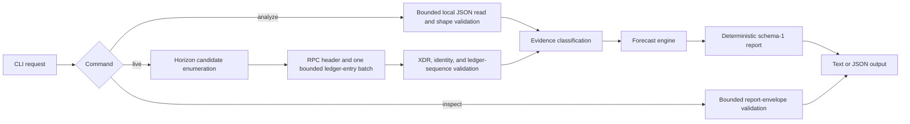

# RevokeTrace architecture

RevokeTrace is a local, read-only Rust CLI for investigating the modeled effect of a Stellar Classic issuer authorization change. It is aimed at issuers, protocol researchers, and maintainers who need a reproducible forecast of a `SetTrustLineFlags` or `AllowTrust` transition, including CAP-0038 liquidity-pool effects.

The program needs ledger evidence because pool membership, reserves, sponsorship, and counters determine the forecast. It applies protocol-specific integer calculations because these effects are not represented by a simple authorization-bit change. It deliberately does not hold keys, construct or sign transactions, submit transactions, repair state, run an indexer, use a database, or offer a hosted service.

## Components and responsibilities

| Component | Actual responsibility |
| --- | --- |
| `src/bin/revoketrace.rs` | Thin process entry point. It passes OS arguments to `cli::run` and exits with the returned documented code. |
| `src/cli.rs` | Parses commands, bounds and validates file and endpoint input, invokes the adapter and engine, renders reports, and performs safe output installation. It contains no authorization or redemption calculation. |
| `src/lib.rs` | Public model types such as `Snapshot` and `OperationSpec`, transition classification, snapshot validation, CAP-0038 forecasting, integer arithmetic, claimable-balance ID derivation, and conservative engine classifications. |
| `src/discovery.rs` | StrKey helpers, bounded HTTP transport, Horizon candidate parsing, Stellar RPC request/response validation, ledger-key and XDR identity checks. |
| `src/evidence.rs` | Live Testnet adapter, header and sponsorship XDR decoding, same-ledger retry/binding, evidence provenance validation, and property-derived evidence classifications. |
| `src/report.rs` | Versioned schema-1 report projection, stable ordering, JSON serialization, and human-readable rendering. It deliberately does not forecast. |

The public interface is the `revoketrace` binary. `analyze` takes a local snapshot, `live` performs a bounded Testnet observation, and `inspect` renders a saved report envelope without authenticating or recomputing it. The complete option, schema, error, and exit-code contract is in [the CLI reference](cli.md).

## Data flow

For offline analysis, `execute_analyze` reads at most 8 MiB, deserializes a `Snapshot` or capture artifact, validates the snapshot shape, asks `AuthoritativeEvidenceAdapter::validate_and_classify` to derive evidence status, calls `evaluate`, then converts the engine result with `ReportDocument::from_engine`.

For live analysis, `execute_live` accepts only the Testnet passphrase and validated HTTPS endpoints. `AuthoritativeEvidenceAdapter::acquire_live_evidence` first uses Horizon to enumerate the caller's candidate balances, builds no more than 200 RPC ledger keys, then obtains a ledger header and the matching `getLedgerEntries` batch. It validates XDR, requested-key identity, pool IDs, sponsorship extensions, and the matching ledger sequence. If the ledger advances during capture it retries a bounded number of times; a persistent mismatch fails closed. The resulting observation is `BOUNDED_CURRENT_TIP_RPC`, not a full ledger export.

`inspect` only deserializes a bounded report and calls `ReportDocument::validate_schema`. It preserves the saved classification and never treats a manifest, provenance label, or report body as authenticated ledger evidence. Its text output uses a separate renderer (`render_human_inspection`) that opens with a not-verified notice and labels every copied value as a saved claim. Its JSON output stays the unchanged schema 1 document, with the same notice on standard error.

## Trust and authority boundaries

Snapshots, capture-artifact metadata, manifest values, and saved reports are caller-controlled. Horizon responses and Stellar RPC JSON/XDR are remote, untrusted inputs. The implementation independently checks format, size, StrKeys, requested key correspondence, canonical pool-ID derivation, entry identities, XDR decoding, ledger-sequence consistency, and certain counter relationships.

Those checks establish integrity of the bounded inputs the program received. They do not establish that Horizon enumerated every relevant pool, that a current-tip observation proves a past ledger state, or that a caller-provided export is complete. `liquidityPoolUseCount` reconciliation is useful validation under its stated assumptions, but it is not an independently verified complete-capture mechanism in this release.

Evidence and forecast classifications are separate. A caller cannot make a snapshot `COMPLETE_AUTHORITATIVE_LEDGER` by supplying that label. `SUPPORTED_SAFE` is reserved and not emitted. `UNVERIFIED_FORECAST` and `SUPPORTED_BLOCKED` are modeled results, not transaction approval or a complete network preflight. See [scope](scope.md) and [verification evidence](verification.md).

## Interfaces and compatibility

Reports use `schema_version: 1` and type `revoketrace.forecast`. They carry the requested operation, derived evidence status, modeled forecast, diagnostics, and limitations. Equivalent validated inputs serialize in deterministic order. The binary uses exit codes to distinguish successful command execution, warnings, inconclusive evidence, unsupported behavior, invalid input, network failure, output failure, and internal failure.

Live mode is limited to Stellar Testnet. Every path applies one protocol policy (`src/protocol.rs`): protocol versions 18 to 29 are evaluated and any other observed version is refused as `UNSUPPORTED` (exit code 30). A snapshot with no protocol version is evaluated with the warning `W_PROTOCOL_UNVERIFIED`. The code uses `stellar-xdr` 28.0.1. This is generated-XDR compatibility for the stated scope, not an assertion that future protocol or XDR releases are automatically supported. The reasoning for the 18 to 29 range is in the [protocol support decision](../research/protocol-support-decision.md). The source and test evidence is indexed in [verification](verification.md).

## Current design boundaries

Rust and a CLI keep the evaluator local, portable, and easy to reproduce. Offline input supports investigation without network access. The bounded live adapter avoids operating persistent infrastructure and lets the program validate the exact response set it consumes. Those choices also mean it intentionally does not provide an indexer, database, backend, dashboard, authoritative historical capture, or ledger-wide completeness proof. The repository's historical research records proposals and feasibility arguments; the released implementation and its present limits are described here rather than inferred from those records.
