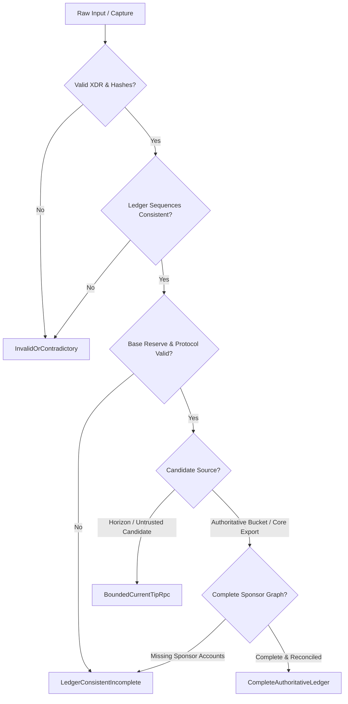

# Authoritative Ledger Evidence Audit and Source Evaluation

**Phase:** Phase 4A (Authoritative Ledger Evidence)  
**Date:** 2026-10-27  
**Status:** Defensible Technical Specification and Source Analysis  

---

## 1. Merged Baseline Audit

In Phase 1C, RevokeTrace implemented a bounded two-tier candidate discovery prototype:
- **Tier 1:** Untrusted candidate enumeration querying Horizon `GET /accounts/{trustor}` balances.
- **Tier 2:** Single-batch atomic verification querying Soroban RPC `getLedgerEntries` at the current tip, asserting `liquidityPoolUseCount` reconciliation and cryptographically deriving canonical CAP-0038 pool IDs.

However, the merged baseline leaves clear gaps between bounded discovery evidence and a complete, ledger-consistent preflight snapshot:

| Preflight Input Requirement | Baseline Status | Technical Reality in Baseline | Authoritative Source Requirement |
| :--- | :--- | :--- | :--- |
| **1. Complete snapshot at defined ledger** | Incomplete | Query is bounded to requested keys at current tip; historical point-in-time state is unretrievable over public RPC. | Provable snapshot boundary bound to a defined ledger sequence and ledger hash. |
| **2. Affected pool-share trustlines** | Inferred | Discovered via Horizon candidate list; reconciled against `liquidityPoolUseCount` only for credit trustlines with V2 extension. | Authoritative enumeration of all trustlines pairing the revoked asset. |
| **3. Credit trustline & counter** | Available | Retrievable via RPC `getLedgerEntries` at current tip. | Verifiable at specified ledger with protocol-valid flags and counter. |
| **4. Referenced liquidity pools** | Available | Retrievable via RPC; canonical pool IDs derived via `derive_constant_product_pool_id`. | Validated constant-product parameters and non-negative reserves. |
| **5. Entry sponsorship info** | **Missing** | Wire `RpcEntry` discarded `extXdr`; entry-level `sponsoring_id` was left as `None`. | Must parse `extXdr` (`LedgerEntryExt::V1(ext_v1).sponsoring_id.0`) for trustlines and pools. |
| **6. Sponsor counters & liabilities** | **Missing** | Account entries record `num_sponsoring` / `num_sponsored`, but third-party sponsor accounts were not fetched. | Must fetch and verify all referenced sponsor accounts if entries are sponsored. |
| **7. Base-reserve configuration** | **Missing** | Set to `None` in discovery output, causing `evaluate` to fail with `"base reserve is unavailable"`. | Must obtain authoritative `base_reserve` from `LedgerHeader` via RPC `getLatestLedger`. |
| **8. Provable state boundary** | Incomplete | Bounded to single batch ($\le 200$ keys) at `latestLedger`; no proof that other entries do not exist. | Cryptographic commitment (BucketList hash / complete ledger export). |
| **9. Protocol version & network identity** | Inferred | Network passphrase in manifest; protocol version was not extracted from header. | Authoritative extraction of `protocolVersion` ($\ge 18$) from `LedgerHeader` / `getLatestLedger`. |

### Critical Finding: Reconciliation Does Not Prove Historical Discovery
A successful Horizon/RPC count reconciliation ($K == N$) proves that for the current tip $L_{\text{rpc}}$, all $N$ pool-share trustlines counted by Stellar Core in `liquidityPoolUseCount` were present in the single batch.
However, it **does not** prove historical discovery at ledger $L < L_{\text{rpc}}$:
1. `lastModifiedLedgerSeq <= L` on returned entries does not prove an entry was unchanged since ledger $L$, nor does it detect entries deleted between $L$ and $L_{\text{rpc}}$.
2. Horizon only stores current state; historical positions deleted on-chain cannot be discovered through Horizon.
3. Soroban RPC `getLedgerEntries` ignores the `ledger` parameter, returning live tip state.

---

## 2. Investigation of Authoritative Ledger Sources

We investigated four potential sources against current Stellar documentation and source code:

### Source A: Stellar RPC (`getLatestLedger` + `getLedgerEntries` with `extXdr`)
- **Capabilities:**
  1. `getLatestLedger` returns `protocolVersion`, `sequence`, and base64-encoded `headerXdr`.
  2. `headerXdr` decodes into `stellar_xdr::curr::LedgerHeader`, exposing `base_reserve` (in stroops), `ledger_version`, `bucket_list_hash`, and `ledger_seq`.
  3. `getLedgerEntries` returns `entries` containing `key`, `xdr` (`LedgerEntryData`), `lastModifiedLedgerSeq`, and `extXdr` (`LedgerEntryExt`).
  4. Decoding `extXdr` allows extracting `sponsoring_id: Option<AccountId>` for trustlines and pools.
- **Boundaries:**
  - Bounded to $\le 200$ keys per batch.
  - Current tip only; ignores historical ledger requests.
  - Zero local storage or background daemons required.

### Source B: History Archive Snapshots (HAS / BucketList)
- **Capabilities:**
  - Stellar History Archives publish immutable checkpoint files every 64 ledgers.
  - Contains complete state BucketList snapshots and transaction/ledger history.
- **Boundaries:**
  - Checkpoints occur only every 64 ledgers (~5 minutes lag).
  - Mainnet BucketLists exceed 30 GB compressed; Testnet is multiple GBs.
  - Requires heavy network downloads, disk caching, and XDR stream parsing.
  - Violates the lightweight, instant CLI preflight requirement.

### Source C: Captive Core Process
- **Capabilities:**
  - Invoking `stellar-core` in captive mode allows running an embedded consensus node that streams authoritative ledger changes or dumps state snapshots into an ephemeral SQLite database or memory.
- **Boundaries:**
  - Requires compiling and distributing architecture-specific native `stellar-core` binaries (Linux x86_64/arm64, macOS arm64/x86_64, Windows).
  - Requires catchup sync time, substantial bandwidth, and disk space for storage.
  - Not installed on standard user machines (`which stellar-core` fails on typical developer systems).

### Source D: Ledger-Close Metadata Reader (Delta vs. Complete State)
- **Capabilities:**
  - Stellar Core emits `LedgerCloseMeta` for every closed ledger, recording `LedgerEntryChange` events (created, updated, deleted).
- **CRITICAL DISTINCTION: DELTA IS NOT A SNAPSHOT:**
  - `LedgerCloseMeta` contains **only** entries modified in that ledger.
  - A pool-share trustline or account created in an earlier ledger does not appear in `LedgerCloseMeta` unless modified in that ledger.
  - Treating a single `LedgerCloseMeta` delta as a complete snapshot is **fatal**: it leads to complete omission of active trustlines.
  - A delta reader can only produce complete state if it replays contiguous changes from a known checkpoint or genesis.

---

## 3. Smallest Viable Architecture

In accordance with project constraints (CLI-first, read-only, zero paid services, no permanent daemon/database):

1. **For Live Network Execution (Bounded Current-Tip Verification):**
   - Acquire network state through Stellar RPC by combining:
     - `getLatestLedger` to extract `base_reserve` and `protocolVersion` from `headerXdr`.
     - `getLedgerEntries` parsing both `xdr` (`LedgerEntryData`) and `extXdr` (`LedgerEntryExt`) to extract actual entry-level sponsorship descriptors.
     - Candidate enumeration via Horizon, validated against on-chain `liquidityPoolUseCount`.
   - **Classification:** `BoundedCurrentTipRpc` (not `CompleteAuthoritativeLedger`).
   - Forecast safety classification remains strictly `UnverifiedForecast`. `SupportedSafe` remains unreachable.

2. **For Offline Reproducible Verification (Authoritative Ledger Capture):**
   - A standardized machine-readable capture artifact (`AuthoritativeEvidenceCapture`) that records:
     - Protocol version, network passphrase, ledger sequence, ledger header hash, bucket list hash.
     - Authoritative `base_reserve` in stroops.
     - Complete entry state: trustor account, issuer account, credit trustline, all affected pool-share trustlines, liquidity pool entries, and all sponsor accounts.
     - Exact `extXdr` sponsorship descriptors and counter reconciliations.
   - **Classification:** Derived through rigorous property verification:
     - If all 9 criteria are cryptographically and structurally satisfied $\to$ `CompleteAuthoritativeLedger`.
     - If any required input or sponsorship link is missing $\to$ `LedgerConsistentIncomplete`.
     - If contradictory or sequence-mismatched $\to$ `InvalidOrContradictory`.

---

## 4. Strict Evidence Trust Model

Evidence status must be strictly derived from **verified properties**, never from caller-supplied metadata:

### Classification Definitions:

1. **`UntrustedCandidate`:**
   - Raw candidate pool IDs or unverified manifest keys without on-chain RPC verification.
2. **`BoundedCurrentTipRpc`:**
   - Bounded single-batch RPC verification against `getLedgerEntries` and `getLatestLedger` at the current tip. `liquidityPoolUseCount` reconciles with discovered pools, `base_reserve` and `sponsoring_id` are parsed, but the candidate source is bounded or untrusted (Horizon), and historical state is unproven.
3. **`LedgerConsistentIncomplete`:**
   - Entries belong to the same ledger sequence, but the evidence lacks required preflight inputs (e.g. missing `base_reserve`, missing third-party sponsor accounts, missing issuer account, or incomplete coverage).
4. **`CompleteAuthoritativeLedger`:**
   - Sourced from an authoritative ledger export or verified complete state; all affected pool shares, credit trustlines, constant-product pool derivations, sponsor accounts, and header base-reserve values are verified.
5. **`InvalidOrContradictory`:**
   - Mismatched ledger sequences, corrupted XDR, conflicting flags, negative balances/reserves, pool ID derivation mismatch, missing deletion records, or tampered manifest hashes.

---

## 5. Verification of Ledger Consistency

1. **State vs. Delta:** A delta (`LedgerCloseMeta`) must never be treated as complete state. The adapter rejects deltas presented as snapshots unless accompanied by a complete base state.
2. **One Ledger State:** All entries in the snapshot must have `last_modified_ledger_seq <= ledger_sequence`. Entries with `last_modified_ledger_seq > ledger_sequence` fail closed as `InvalidOrContradictory`.
3. **Historical State:** `lastModifiedLedgerSeq <= L` on a tip read does not prove historical validity at $L$. The adapter explicitly marks any tip read as `BoundedCurrentTipRpc`, refusing historical completeness claims.
4. **Network-Pinned:** All manifest hashes bind the network passphrase, target ledger sequence, and sorted pool IDs.
5. **Fail-Closed Guarantee:** Under all incomplete, ambiguous, or contradictory conditions, preflight evaluates to `Inconclusive` or `SupportedBlocked`. `SupportedSafe` remains strictly unreachable.
