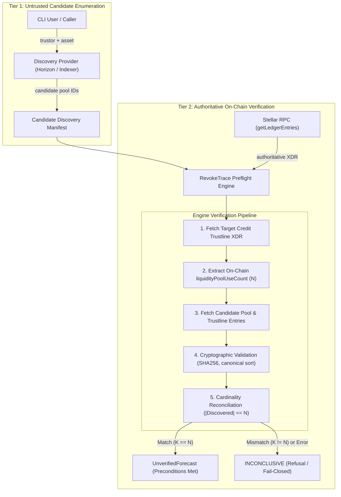

# Selected Discovery Architecture: Two-Tier Verifiable Discovery

> **Historical research notice, 2026-10-27.** This document preserves a conditional completeness argument for the proposed architecture. Its reconciliation theorem remains useful only when its stated inputs are valid, complete, and from the same ledger, and when the Core invariant holds. v1.0.0 implements bounded current-tip Horizon/RPC acquisition and reports `BOUNDED_CURRENT_TIP_RPC`; it does not independently demonstrate exhaustive or historical ledger capture. Read the current [architecture](../docs/architecture.md), [scope](../docs/scope.md), and [verification index](../docs/verification.md) before treating this proposal as a release capability.

Research date: 2026-10-27.  
Scope: Architecture selection and rationale for discovering affected pool-share trustlines in RevokeTrace.

---

## 1. Architectural Choice: Two-Tier Verifiable Discovery

To achieve **complete discovery without running a permanent database or a heavyweight captive-core node**, RevokeTrace selects a **Two-Tier Verifiable Discovery Architecture**:

### Tier 1: Untrusted Candidate Enumeration
- **Role**: Generate candidate pool IDs for `(trustor, revoked_asset)`.
- **Sources**: Can be supplied by SDF Horizon (`GET /accounts/{id}` balances), an external indexing service, or a caller-provided manifest file.
- **Trust Assumption**: **Zero trust**. The candidate list is treated as untrusted input. An adversary or buggy API could omit pools, inject spurious pools, or supply mixed-ledger data.

### Tier 2: Authoritative Ledger-Complete Verification
- **Role**: Independently prove mathematical completeness and ledger consistency using authoritative Stellar RPC `getLedgerEntries`.
- **Verification Steps**:
  1. **Anchor Target Ledger**: Request entries at target ledger $L$. Enforce `lastModifiedLedgerSeq <= L` on all returned entries.
  2. **Authoritative Count Extraction**: Read the target credit trustline XDR (`TrustLineEntryExtensionV2`). Extract `N = liquidityPoolUseCount`.
  3. **Candidate Validation**: For each candidate pool:
     - Fetch the pool-share trustline for `(trustor, pool_id)`. Verify it exists and is owned by `trustor`.
     - Fetch the `LiquidityPoolEntry` for `pool_id`.
     - Verify `SHA256(assetA, assetB, fee) == pool_id` and canonical ordering `assetA < assetB`.
     - Verify that either `assetA == revoked_asset` or `assetB == revoked_asset`.
     - Verify distinctness (no duplicate `pool_id`s).
  4. **Cardinality Reconciliation Check**:
     $$\text{Verified Matching Pools Count } K \stackrel{?}{=} N$$
     - If $K == N$: The candidate set is proven to be **exhaustive** and **ledger-complete**.
     - If $K < N$: One or more pools were omitted. Refuse closed: return `INCONCLUSIVE`.
     - If $K > N$ or candidate pool does not contain the asset: State is contradictory. Refuse closed: return `INCONCLUSIVE`.

---

## 2. Mathematical Completeness Proof

### Theorem: Exhaustive Discovery under Protocol 18+ Invariant
Given a target credit trustline $T$ on account $A$ for credit asset $C$ at ledger $L$:

1. By CAP-0038 protocol invariant (enforced in `ChangeTrustOpFrame.cpp:76-78`), every liquidity-pool share trustline owned by $A$ whose pool constituents include $C$ increments $T.\text{liquidityPoolUseCount}$ by exactly 1 upon creation.
2. By CAP-0038 protocol invariant (enforced in `TransactionUtils.cpp:1876-1881`), every such pool-share trustline decrements $T.\text{liquidityPoolUseCount}$ by exactly 1 upon deletion or revocation.
3. Trustline keys on Stellar are unique: an account $A$ cannot hold multiple trustlines for the same `pool_id`.
4. Therefore, at ledger $L$, the total number of live pool-share trustlines on $A$ containing $C$ is identically equal to $T.\text{liquidityPoolUseCount} = N$.
5. If an verifier validates $K$ distinct, live pool-share trustlines on $A$ at ledger $L$, each cryptographically proven to reference $C$, and observes $K = N$, then:
   $$\text{Discovered Set} \equiv \text{Affected Set On-Chain}$$
   **No affected pool-share trustline can be missing.**

---

## 3. Classification Categorization

Per the specification, we explicitly categorize discovery capabilities across Stellar data access methods:

| Category | Definition | Architectural Status |
| --- | --- | --- |
| **1. Complete discovery demonstrated** | Reproducible live execution establishing mathematical completeness against an on-chain ledger invariant at an arbitrary historical ledger. | **Not demonstrated on live network**. Stored fixture replay demonstrates the offline mathematical proof, but live network discovery at an arbitrary historical ledger remains unproven due to public API limitations. |
| **2. Complete discovery technically plausible but not demonstrated** | Architectures that can theoretically achieve completeness but require unverified infrastructure or full-node execution. | **Two-Tier Architecture on Live Tip** and **Captive-Core standalone replay** (plausible via single-batch tip read or history archive replay, but unproven for arbitrary historical queries over public RPC). |
| **3. Complete discovery unavailable or unsupported** | Methods incapable of providing completeness guarantees. | **Stellar RPC alone** (lacks enumeration) and **Horizon API alone** (drops `liquidityPoolUseCount`, unverified off-chain DB, ignores ledger parameters). |

### Overall Feasibility Verdict: DISCOVERY FEASIBILITY PLAUSIBLE BUT UNPROVEN

While the in-protocol `liquidityPoolUseCount` invariant and canonical parameter derivation provide a rigorous mathematical basis for verifying discovery completeness, live discovery remains **PLAUSIBLE BUT UNPROVEN** because:
1. Public Stellar RPC does not support point-in-time querying at arbitrary historical ledgers.
2. Horizon does not expose the required `liquidityPoolUseCount` counter and lacks cryptographic inclusion proofs.
3. Achieving live completeness requires either accepting single-batch tip queries (bounded by 200 keys) or operating a heavyweight Captive-Core instance.

---

## 4. Why Lighter Alternatives Fail

1. **Why not Horizon alone?**
   Horizon's REST response drops `liquidityPoolUseCount` and does not provide Merkle/BucketList proofs. If a network issue, cursor truncation, or ingestion glitch causes Horizon to omit a pool, a preflight tool trusting Horizon would underestimate reserve requirements and report a false success.
2. **Why not RPC alone?**
   Stellar RPC has no secondary indexing. To query `getLedgerEntries`, the caller must already supply the 32-byte SHA-256 pool IDs. Because counter-assets are unbounded, RPC alone cannot generate the key list.

---

## 5. Security & Safety Contract Adherence

- **Maximum Classification**: Even when Tier 2 verification succeeds with $K == N$, RevokeTrace assigns at most `UnverifiedForecast`. The classification `SupportedSafe` remains reserved for future trusted capture adapters with signed provenance.
- **Fail-Closed on Discrepancy**: Any missing entry, counter mismatch, mixed ledger sequence, or XDR decoding error immediately results in `INCONCLUSIVE`.
- **Zero Ledger Mutation**: Read-only JSON-RPC queries; no secret keys, transaction signing, or network submission.
