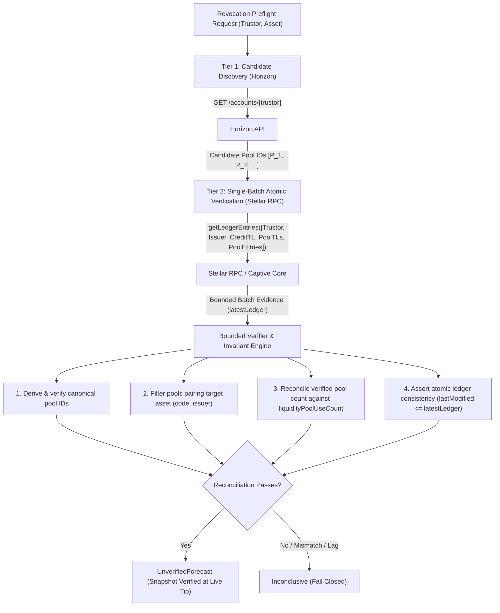

# Discovery Sources: Comparative Evaluation

**Phase:** Phase 1C (Discovery Source and Ledger Consistency)  
**Date:** 2026-10-27  
**Status:** Research-only feasibility evidence  

---

## 1. Problem Statement: Missing Capabilities from Phase 1B

In Phase 1B, RevokeTrace demonstrated:
1. Cryptographic derivation of CAP-0038 constant-product liquidity pool IDs.
2. On-chain cardinality reconciliation against `TrustLineEntryExtensionV2.liquidityPoolUseCount`.
3. Single-batch atomic querying of 5 known ledger keys via Stellar RPC `getLedgerEntries`.

However, Phase 1B did **not** achieve autonomous discovery completeness:
- **Caller-Supplied Manifest:** The 5 ledger keys (including pool IDs) were supplied by the caller or fixture. RevokeTrace could not discover pool IDs given only the trustor account and credit asset.
- **RPC Blind Enumeration Gap:** Stellar RPC `getLedgerEntries` requires explicit `LedgerKey` inputs; it cannot query "all pool-share trustlines owned by account X".
- **Historical Consistency Gap:** Soroban RPC `getLedgerEntries` ignores the `ledger` parameter, serving only the live tip.

The mission of Phase 1C is to establish and verify the smallest practical, read-only mechanism to discover all candidate pool-share trustlines without requiring caller-supplied pool IDs, while verifying atomicity, consistency, and fail-closed safety.

---

## 2. Comparative Evaluation of Candidate Discovery Sources

| Source Approach | Candidate Enumeration | Historical Point-in-Time | Single-Ledger Atomicity | Operational Footprint | Omission Detection |
| :--- | :--- | :--- | :--- | :--- | :--- |
| **A. Stellar RPC Alone** | **Unsupported** (requires explicit keys) | **Unsupported** (tip only, ignores `ledger`) | **Supported** (within single batch of $\le 200$ keys) | Minimal (read-only HTTP) | N/A (cannot enumerate candidates) |
| **B. Horizon Account Balances** | **Supported** (`GET /accounts/{id}` balances) | **Unsupported** (tip/ingested state only) | **Weak** (independent database; drift vs Core) | Low (public HTTP endpoint) | **Supported** (via on-chain counter reconciliation) |
| **C. Stellar History Archives (HAS)** | **Supported** (BucketList dump parsing) | **Supported** (every 64-ledger checkpoint) | **Authoritative** (cryptographically committed) | **Prohibitive for CLI** (multi-GB downloads, 5-min lag) | Authoritative |
| **D. Captive Core Ingestion** | **Supported** (in-memory SQLite / stream) | **Supported** (bounded historical ledger sync) | **Authoritative** (direct Core consensus) | **Heavy** (requires local binary, sync, disk) | Authoritative |
| **E. Two-Tier Candidate Discovery (Selected for spike)** | **Supported** (Horizon candidates + RPC verification) | **Bounded Tip Only** (tip snapshot; historical unproven) | **Bounded** (single-batch response-set and identity checks) | **Minimal** (zero-storage, CLI-friendly) | **Counter reconciliation for the supplied candidate set only** |

---

## 3. Detailed Source Analyses

### A. Stellar RPC (`getLedgerEntries`)
- **API Contract:** RPC `getLedgerEntries` takes an array of base64-encoded `LedgerKey` XDR structs and returns corresponding `LedgerEntryData` and `lastModifiedLedgerSeq`.
- **Blind Enumeration:** Completely unsupported. An account's subentries cannot be enumerated by account ID alone.
- **Historical Retrieval:** Unsupported. The RPC method accepts an optional `ledger` parameter, but empirical tests on Stellar Testnet confirm it is silently ignored, always returning the node's current `latestLedger`.
- **Atomicity:** Bounded single-batch atomicity is guaranteed across all keys requested in a single call (up to 200 keys), because the Captive Core backing RPC evaluates the batch against a single locked ledger close snapshot.

### B. Horizon Account Liquidity Pool Views
- **API Contract:** `GET /accounts/{account_id}` returns a JSON representation of the account including an array of `balances`.
- **Pool-Share Representation:** When an account holds pool-share trustlines, Horizon outputs:
  ```json
  {
    "asset_type": "liquidity_pool_shares",
    "liquidity_pool_id": "00171ffe02f113eb286c4fe0642ceb9f1b508e09c6160374a22bb9ab4240ad46",
    "balance": "60.0000000",
    "limit": "922337203685.4775807",
    "last_modified_ledger": 2518462
  }
  ```
- **Candidate Discovery:** Horizon provides blind candidate enumeration for a target trustor without requiring the caller to supply any pool ID in advance.
- **Pagination Risk:** For `/accounts/{account_id}`, balances are returned as a flat array within the account object, bounded by the maximum subentry limit of the account. There is no pagination cursor within an account's balance array.
- **Consistency Limitation:** Horizon is an indexer running an asynchronous ingestion pipeline behind Stellar Core. It is subject to:
  1. Ingestion lag (Horizon's `latest_ledger` may lag Stellar Core).
  2. Indexer retention pruning.
  3. Network drift between separate calls.
- **Crucial Mitigating Insight:** Horizon cannot be trusted as an authoritative completeness proof *on its own*. However, Horizon can serve as an **untrusted candidate generator**, whose output is strictly verified against on-chain Stellar Core data.

### C. Stellar History Archives (HAS)
- Stellar Core publishes immutable checkpoint files to history archives every 64 ledgers (sequences $63, 127, 191, \dots$).
- These files contain the cryptographic BucketList, representing the entire ledger state at the checkpoint.
- **Why It Fails CLI Suitability:**
  - Checkpoints occur only every ~5 minutes (64 ledgers $\times$ 5 seconds). State between checkpoints requires replaying ledger-close meta diffs.
  - BucketList files are tens of gigabytes compressed on Mainnet.
  - Downloading, decompressing, and scanning multi-gigabyte XDR buckets for an interactive preflight CLI tool violates the low-overhead, fast-turnaround requirement.

### D. Captive Core Ingestion
- Embedding or invoking `stellar-core` as a captive process allows streaming authoritative ledger entries directly into an ephemeral SQLite database or memory index.
- **Trade-off:**
  - High fidelity and full historical point-in-time capability.
  - Requires compiling or bundling `stellar-core` native binaries for all target architectures (Linux, macOS, Windows).
  - Requires substantial bandwidth and initial sync time.
  - Unsuitable for a standalone, single-binary Rust CLI tool without heavy external dependencies.

---

## 4. The Selected Practical Architecture: Two-Tier Verifiable Discovery

To achieve autonomous candidate discovery without heavy infrastructure, RevokeTrace adopts a **Two-Tier Verifiable Discovery** pattern:



### What This Spike Demonstrates:
1. **Autonomous candidate seeding:** The caller provides `(trustor, asset)` and Horizon supplies candidate pool IDs, but Horizon remains an untrusted indexer.
2. **Bounded response verification:** Duplicate, unexpected, missing, malformed, or contradictory RPC entries fail closed. Decoded account, trustline, pool-share, and pool identities are checked against their requested keys.
3. **Single-batch evidence:** Candidate pools and target entries are requested in one batch subject to the documented 200-key limit; all returned entries must satisfy `lastModifiedLedgerSeq <= latestLedger`.
4. **Counter reconciliation boundary:** `liquidityPoolUseCount` reconciles the supplied candidate set at the queried tip, but does not independently prove that an undiscovered candidate never existed or establish historical completeness.
5. **Incomplete preflight boundary:** The response does not establish base-reserve configuration or sponsorship identities/counters. The result is discovery evidence only; `SupportedSafe` remains unreachable.
